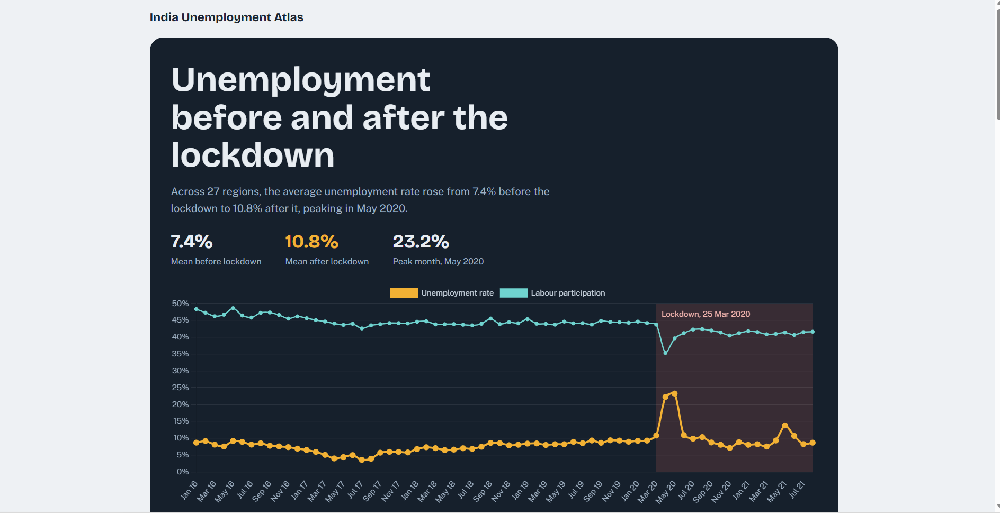
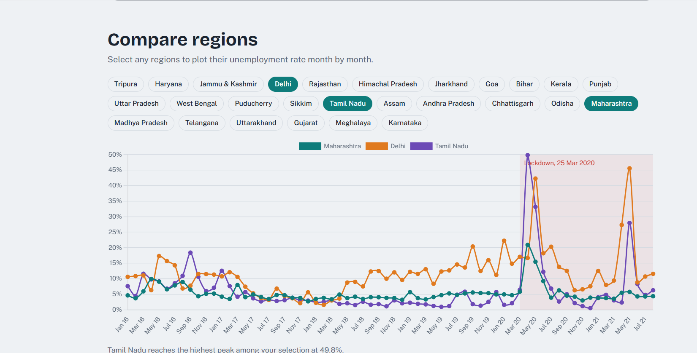
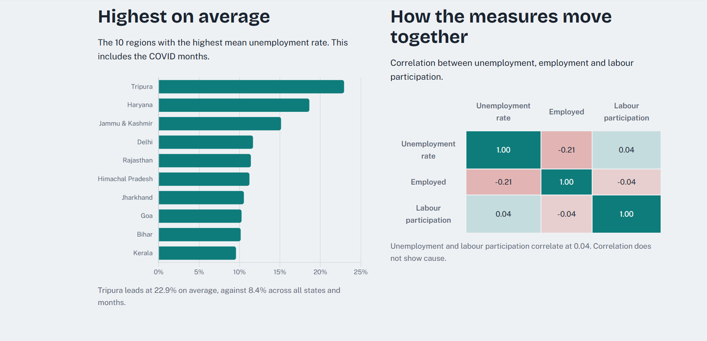
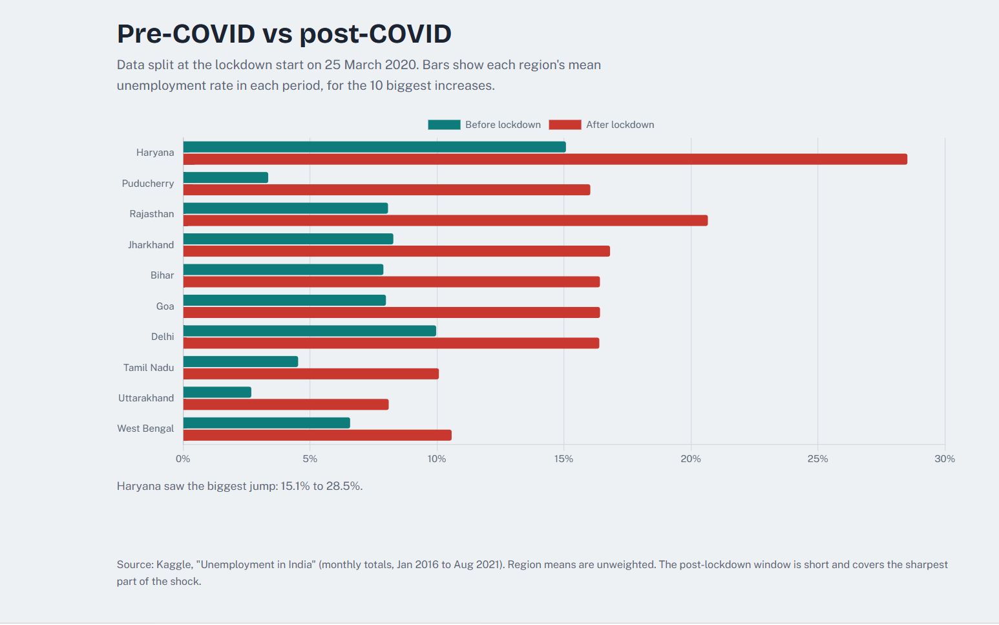

# Unemployment in India, 2016 to 2021

I wanted to see how much the COVID-19 lockdown changed unemployment in India, and whether some states took a harder hit than others. This project answers that with a Jupyter notebook for the full analysis and a small web dashboard, built with Python, that you can put online on Vercel.

## Screenshots

The main page, with the average unemployment rate across states and the lockdown marked:



Comparing a few regions month by month:



The ten regions with the highest average, and how the three measures relate:



The average by calendar month, with and without 2020:


Before and after the lockdown, for the ten regions where the average rose the most:



## What's in the folder

```
.
├── app.py                 Flask app with the API routes
├── analysis.py            all the pandas work behind the charts
├── public/                the dashboard page (HTML, CSS, JS, plus Chart.js)
├── data/unemployment.csv  the data
├── notebook/              the original notebook analysis
├── screenshots/           pictures of the dashboard for this README
├── requirements.txt
└── vercel.json
```

## The data

It's the Kaggle dataset "Unemployment in India". I used the monthly totals file, which has one row per state per month from January 2016 to August 2021.

A few things worth knowing:

- I deleted the title line above the column names and saved a clean copy as `data/unemployment.csv`.
- The file has rows for "India" as a whole. I leave those out so the national figure isn't counted as another state. That leaves 27 states.
- Some states are missing months. Sikkim has 33, Meghalaya 44 and Tripura 47, while the rest have 67 or 68.

## Run it on your computer

You need Python 3.9 or newer.

```
python -m pip install -r requirements.txt
python -m flask --app app run
```

Then open http://127.0.0.1:5000. I use `python -m` because the plain `pip` and `flask` commands were blocked on my laptop. If they work for you, you can use those.

## Put it online with Vercel

The easy way:

1. Push this folder to a GitHub repository.
2. Go to vercel.com/new and import the repository.
3. Leave the settings as they are and click Deploy. Vercel spots the Flask app on its own.

If you'd rather use the command line:

```
npm i -g vercel
vercel
```

If the project sits inside a subfolder of a bigger repository, set the Root Directory to that subfolder when you import it.

## How it works

`analysis.py` loads the CSV with pandas and works out everything the dashboard shows. `app.py` hands that over as JSON at `/api/dashboard`, and `/api/compare` returns the lines for whichever states you pick. The page in `public/` fetches those and draws the charts with Chart.js (a copy is saved in `public/`, so it works without internet). Vercel serves `public/` directly and runs `app.py` for the `/api` routes.

## What the dashboard shows

- **The big picture.** The average unemployment rate across states by month, with the lockdown marked.
- **Compare states.** Pick any states and see their lines side by side.
- **Highest on average.** The ten states with the highest average rate.
- **Do the measures move together?** A correlation table for unemployment, employment and labour participation.
- **Average by calendar month.** All the Januaries together, and so on, with and without 2020.
- **Before and after the lockdown.** The ten states where the average rose the most.

## What I found

- Before the lockdown, unemployment averaged about 7.4% across states.
- It jumped to 22.2% in April 2020 and 23.2% in May 2020, then came back down to around 11% by June.
- There was a smaller rise in May 2021, probably the second COVID wave.
- States were hit very differently. Tamil Nadu, Bihar and Delhi each went above 40% for a month.
- The states with the highest averages overall (Tripura, Haryana, Jammu & Kashmir) aren't quite the ones that rose the most after the lockdown (Haryana, Puducherry, Rajasthan).
- Averaged over the whole "after" period, unemployment only went from 7.4% to 10.8%. That looks small next to the monthly chart because the period runs to August 2021 and includes the recovery.

## Things to keep in mind

- State averages aren't weighted by population, so a small state counts as much as a big one.
- Some states are missing months.
- The "after" average mixes the worst months with the recovery, so it understates how bad April and May 2020 were.
- A correlation only shows that two things move together, not that one causes the other.

## Tools

Python, pandas, Flask and Jupyter for the analysis and the API. Plain HTML, CSS and JavaScript with Chart.js for the page.
